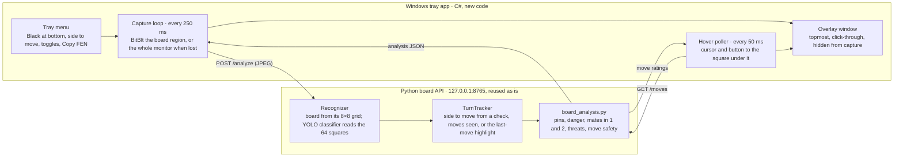

# ChessVision Overlay for Windows: Spec

Rebuild the macOS ChessVision Overlay (`macos/ChessVisionOverlay`) as a Windows tray app in C# (.NET 8, WPF) that reuses the existing Python board API unchanged; only screen capture, the overlay window, hover tracking and the tray menu are new code.

Written 2026-11-24 from the macOS app's Swift sources and `scripts/board_api.py`. Nothing here has been tried on Windows yet.

## Scope and stack

The Python side (board detection, square classifier, analysis, local HTTP API) moves to Windows unchanged; only the native shell that the macOS app implements in Swift is rewritten.

| Part | macOS today | Windows |
| --- | --- | --- |
| Board detection, classifier, analysis | `chessvision/digital_board.py`, `chessvision/board_analysis.py`, `weights/yolo_classifier_screenshots.pt` | Reused unchanged |
| Local HTTP API | `scripts/board_api.py` on 127.0.0.1:8765 | Reused; one change to use CUDA (see Python backend) |
| Screen capture | ScreenCaptureKit, own app left out of the image | GDI `BitBlt` of the board region; overlay hidden from capture with `SetWindowDisplayAffinity` |
| Overlay window | Borderless transparent `NSWindow` that ignores the mouse | WPF window: transparent, topmost, click-through, no taskbar entry |
| Drawing | AppKit paths in `OverlayDrawing.swift` | WPF `DrawingContext`, same geometry and colours |
| Menu | Menu-bar item "♞" | Notification-area (tray) icon with a context menu |
| Hover tracking | `NSEvent.mouseLocation` polled every 50 ms | `GetCursorPos` and `GetAsyncKeyState(VK_LBUTTON)` polled every 50 ms |
| API process | `Process` started from the app bundle's `config.json` | `System.Diagnostics.Process` inside a Job Object, so it exits with the app |

Recommended stack: C# on .NET 8 with WPF, one project (`ChessVisionOverlay.Windows`), Windows 10 version 2004 (build 19041) or later, the first build with `WDA_EXCLUDEFROMCAPTURE`. The tray icon uses `System.Windows.Forms.NotifyIcon` (`UseWindowsForms` in the project file). The backend needs Python 3.10 or later, as on macOS.

The overlay counts as outside assistance in live games on chess.com and lichess; ship the same warning as the README.

## Architecture



The capture loop sends each frame to the local API and hands the reply to the overlay; the hover poller asks the API for one piece's move ratings. Every arrow between the two groups is an HTTP call on 127.0.0.1.

## Board API contract

The app needs only these three calls to `scripts/board_api.py` on `http://127.0.0.1:<port>` (default 8765). The server handles one request at a time, so keep at most one `/analyze` in flight, and send every capture to the same server process: its side-to-move tracker learns from consecutive frames.

| Call | Parameters | Returns |
| --- | --- | --- |
| `GET /health` | none | `{"ok": true}` once the model has loaded |
| `POST /analyze` | query `flip` (0 or 1), `region` (0 or 1), `turn` (auto, white or black); body = JPEG or PNG bytes, `Content-Type: image/jpeg`, at most 64 MB | the fields below |
| `GET /moves` | `fen=<piece placement>`, `square=<e.g. e4>` | ratings for every legal move of that piece; 400 on bad input |

`/analyze` response (snake_case JSON). `found`, `image`, `ms` and the four lists are always present; the other fields only when a board was found:

| Field | Type | Meaning |
| --- | --- | --- |
| `found` | bool | a board was found |
| `image` | [w, h] | size of the received image, pixels |
| `bbox` | [x0, y0, x1, y1] | board in image pixels, end-exclusive |
| `fen` | string | piece placement only, no side to move |
| `uncertain` | int | squares whose top class probability is below 0.6 |
| `reused` | bool | board unchanged, previous classification reused |
| `highlights` | [square] | squares with a coloured last-move background |
| `turn` | "white", "black" or null | side to move; null when unknown |
| `turn_source` | string | how it was decided: "check", "saw Nf3", "saw a move taken back", "saw two moves", "last-move highlight", "set in menu" |
| `pins` | [{pinned, pinner, king, color}] | square names, e.g. "c6" |
| `attacked` | [{square, piece, attackers[], defenders, level, reason}] | `level` is "danger" or "defended"; `piece` is a FEN letter (uppercase = White) |
| `mates` | [{side, n, from, to, line[]}] | forced mates in 1 or 2 (first move from → to, `line` in SAN); both sides when `turn` is null |
| `mates_complete` | bool | false when the mate search hit its time limit |
| `threats` | [{side, n, from, to, line[], kind}] | mates the opponent would have if it were their move; `kind` = "mate" |
| `ms` | float | server time for the request, ms |

`/moves` returns `{square, piece, moves: [{to, san, kind, delta}], note?}`. `kind` is safe, trade, blunder, wins or mate; `delta` is the material change in pawns (negative = you lose material). The piece is rated as if its side were to move.

## Capture and recognition loop

One loop runs every 250 ms, start to start (no sleep when a tick overruns), on a background task, never on the UI thread.

1. Skip the tick if the overlay is disabled or the 2-second error backoff is still running.
2. Capture `region` if one is known, else the whole watched monitor. `region` is in physical pixels.
3. Encode the capture as JPEG (quality 90) off the UI thread and `POST /analyze` with `region=1` when a region was captured, plus the current flip and turn mode.
4. If a region capture finds no board, drop the region and repeat steps 2–3 on the whole monitor in the same tick.
5. Still no board: status "No board on screen", clear the overlay, end the tick.
6. Map `bbox` to the screen: board = capture origin + bbox ÷ (image width ÷ captured width). With physical-pixel capture the ratio is 1.
7. Next `region` = the board grown on every side by max(8 px, 5% of its width), clipped to the monitor.
8. Show a position only once the same `fen` has arrived twice in a row, which skips frames caught mid-animation. Until then hide the old annotations rather than show stale ones.
9. On a capture error: clear the overlay, drop the region, recreate the capturer, wait 2 s. On a connection error: also restart the API (see Packaging and configuration).

Status line after a successful tick: "Board at X,Y (W px) · N ms", using the API's `ms`. At startup, poll `/health` every 500 ms for up to 60 s before the first tick; model loading takes a few seconds.

## Overlay drawing

Port `OverlayDrawing.swift` one to one: every size scales with the square size, so the overlay looks the same on any board. With the board rectangle in screen pixels (top-left origin): cell = board width ÷ 8, line = max(2, cell × 0.06), label size = max(9, cell × 0.17).

Square to rectangle: file index f (a = 0) and rank index r (1 = 0); column = flip ? 7 − f : f; row = flip ? r : 7 − r; rectangle = (board.x + column × cell, board.y + row × cell, cell, cell).

| Annotation | Drawn when | Colour (opacity) | Shape | Label |
| --- | --- | --- | --- | --- |
| Piece in danger | `attacked.level` = danger and the piece belongs to the side to move, or `turn` is null | #ED2929 (95%) | Rounded-square ring inset by line, corner radius cell × 0.12, stroke line | none |
| Opponent piece you can win | danger, piece belongs to the other side | #1A8CF2 (95%) | same ring | none |
| Attacker arrows | for each danger piece, if Show attacker arrows | the ring's colour (60%) | arrow from each attacker to the piece, width line × 0.8, stops cell × 0.42 short | none |
| Attacked but defended | level = defended, only if Show attacked but defended (off by default) | #FF9E00 (95%) | same ring | none |
| Pin | each `pins` entry | #9440F2 (line 75%, circle 95%) | dashed line pinner centre → king centre (dash cell × 0.16, gap cell × 0.10, round caps); dashed circle on the pinned piece, inset cell × 0.06 (dash cell × 0.10, gap cell × 0.06) | "PIN" at the pinned square's top-left |
| Mate threat | each `threats` entry | #CC0D33 (85%) | dashed arrow from → to, width line × 1.1, stops cell × 0.30 short | "THREAT #" at the target's bottom-left |
| Forced mate | each `mates` entry | #1AC74D (95%) | solid arrow from → to, width line × 1.4, stops cell × 0.30 short | "M1" or "M2" at the target's top-right; "W " or "B " in front when `turn` is null |
| Side to move | always, if shown | white pill + black text; black pill + white text; grey pill (35% grey, 90%) + white text | pill | "White to move", "Black to move", "Side to move unknown"; size max(10, cell × 0.2), above the board's top-left corner, or just inside the top edge when there is no room above |

Arrows: the shaft starts stopShort × 0.5 from the source centre and ends at the head's base; head length = width × 3.2, half-width = head length × 0.6, filled. Dashed shafts use width × 2.5 on, width × 1.6 off. Skip an arrow shorter than stopShort × 1.5.

Labels: bold Segoe UI at the label size, white text unless stated, on a fully rounded pill of the annotation colour, padded size × 0.3 left and right and size × 0.05 top and bottom.

Draw order: rings and attacker arrows, pins, threats, mates, then every label last so arrows never cover text, then the hover layer on top. Redraw only when the state changes.

## Hover move-safety tracker

A 50 ms timer on the UI thread follows the mouse and rates every square the piece under it can move to. Windows needs no permission to read the cursor.

1. If the overlay is disabled, "Show move safety" is off, or no position is shown, clear the hover and stop.
2. Read the cursor (`GetCursorPos`, physical pixels under per-monitor DPI awareness) and the left button (`GetAsyncKeyState(VK_LBUTTON) & 0x8000`).
3. Button up: forget the drag square. Button down with a drag square and a hover already shown: keep it unchanged, because the dragged piece's square looks empty on screen.
4. Square under the cursor: column = ⌊(x − board.x) ÷ cell⌋ and row = ⌊(y − board.y) ÷ cell⌋, clamped to 0–7; file = flip ? 7 − column : column; rank = flip ? row + 1 : 8 − row. Ignore the square unless the shown FEN has a piece on it.
5. Button just went down on a piece: remember that square as the drag square.
6. If the key "\<fen> \<square>" differs from the last one, cancel any request in flight and `GET /moves`. Draw the reply only if the key is still current when it arrives.

Drawing, with line = max(2, cell × 0.05): a white rounded-square ring (95%) on the piece's own square, then for each move in the reply:

| `kind` | Colour | Label |
| --- | --- | --- |
| safe | #26BF4D | none |
| wins | #26BF4D | +N |
| mate | #26BF4D | # |
| trade | #F7C71A | = (or ±N when `delta` is not 0) |
| blunder | #ED2929 | −N |

- Fill the target square with the colour at 30%.
- Non-capture: a dot of diameter cell × 0.30 at the square's centre, 90%.
- Capture (SAN contains "x"): a ring instead, circle inset cell × 0.07, stroke cell × 0.08, 85%.
- Label size max(9, cell × 0.18), pill in the square's bottom-right at x = right − size × 2 − line, y = bottom − size × 1.45 − line. Text: "#" for mate, else the signed `delta` when it is not 0, else "=" for a trade.

## Tray menu and settings

A notification-area icon (a knight; a warning badge while the API is down) opens this context menu, top to bottom. Unlike the Mac app, which forgets settings on quit, save the checkboxes and choices to `%APPDATA%\ChessVisionOverlay\settings.json`.

1. Status line (disabled), for example "Board at 120,240 (640 px) · 45 ms".
2. "Copy FEN: \<placement>", which copies the full FEN with the known side to move ("w" when unknown; the Mac app always writes "w"), then `- - 0 1`. Disabled as "Copy FEN (no position yet)" when nothing is shown.
3. Info lines (disabled), rebuilt each time the menu opens:
   - "White to move (saw Nf3)", or "Side to move unknown until a move is played (or set it under Side to move)".
   - One "Mate in N for White: \<line in SAN>" per mate, else "No mate in 1 or 2" or "No mate in 1 or 2 found (search cut short)".
   - One "Threat: Black mates with \<line>" per threat.
4. Overlay enabled (checkbox, on).
5. Black at bottom (checkbox, off): sends `flip=1` and clears the overlay.
6. Side to move ▸ Auto (from check, moves seen or last-move highlight) / White / Black (radio, Auto): sent as `turn`; clears the overlay.
7. Monitor ▸ one entry per display (radio, the display under the cursor at launch). New on Windows.
8. Checkboxes: Show move safety when hovering a piece (on), Show mates in 1 and 2 (on), Show mate threats (on), Show pins (on), Show pieces in danger (on), Show attacked but defended pieces (off), Show attacker arrows (on).
9. Legend (disabled lines, the leading symbol in the annotation's colour):
   - ● Hover a piece: green safe, yellow equal trade (=), red loses material (−N)
   - ➜ Green arrow: forced mate (M1 / M2) for the side to move
   - ➜ Dashed red arrow: mate the opponent threatens
   - ■ Red: your piece in danger (check, undefended, or attacked by a cheaper piece)
   - ■ Blue: opponent piece you can win
   - ■ Orange: attacked but defended
   - ■ Purple: pinned to its king
10. Open API log (replaces the Mac's "Open Screen Recording Settings").
11. Quit.

Separators go after items 3, 7, 8, 9 and 10.

## Windows platform specifics

Work in physical pixels everywhere (capture, `bbox`, region, cursor) and convert to WPF units only when drawing; most porting bugs will come from mixing the two.

| Topic | Requirement |
| --- | --- |
| DPI | Declare Per-Monitor V2 DPI awareness in the app manifest. Convert pixels to WPF device-independent units by dividing by the monitor's scale (`VisualTreeHelper.GetDpi`). |
| Overlay window | WPF `Window` covering the watched monitor: `WindowStyle=None`, `AllowsTransparency=True`, `Background=Transparent`, `Topmost=True`, `ShowInTaskbar=False`, `ShowActivated=False`. On `SourceInitialized`, add `WS_EX_LAYERED`, `WS_EX_TRANSPARENT`, `WS_EX_TOOLWINDOW` and `WS_EX_NOACTIVATE` with `SetWindowLongPtr(GWL_EXSTYLE)`, so clicks pass through and it never takes focus or shows in Alt+Tab. |
| Hide from capture | `SetWindowDisplayAffinity(hwnd, WDA_EXCLUDEFROMCAPTURE)` (0x11) as soon as the handle exists, so the overlay never appears in the app's own captures; this replaces the Mac's `SCContentFilter`. If it fails (older Windows), show an error and stop, since the overlay would be recognized as part of the board. |
| Staying on top | When a board is found, re-assert `HWND_TOPMOST` with `SetWindowPos` (`SWP_NOACTIVATE`, `SWP_NOMOVE`, `SWP_NOSIZE`); other topmost windows can cover it. Exclusive-fullscreen apps are out of scope. |
| Capture | GDI: `BitBlt` from the screen DC into a 32-bit DIB section for the region, then JPEG with WIC or `System.Drawing`. Use the monitor's position from `EnumDisplayMonitors` / `GetMonitorInfo`; virtual-screen coordinates can be negative. If a browser region comes back black, switch to Windows.Graphics.Capture (`IsBorderRequired = false`, `IsCursorCaptureEnabled = false`, Windows 11). |
| Monitors | Watch one monitor, chosen in the menu. The Mac app also watches only the main display. |
| Permissions | Windows has no screen-recording permission, so the Mac's permission check, prompt and "♞⚠" state are dropped. |
| Virtual desktops | The overlay shows only on the desktop it was opened on (the Mac's joins every Space). |

## Python backend on Windows

The backend should run on Windows with one code change, using 64-bit Python 3.10 or later and a venv in the repo:

```
py -3.10 -m venv .venv
.venv\Scripts\pip install -r requirements-live.txt
.venv\Scripts\python scripts\board_api.py --port 8765
```

1. GPU: `Recognizer` in `scripts/live_board.py` picks "mps" or "cpu". Make it try "cuda" first (`torch.cuda.is_available()`), then "mps", then "cpu". For an NVIDIA GPU, install a CUDA build of torch from download.pytorch.org instead of the default CPU wheel.
2. CPU only: unchanged boards skip the classifier, so CPU may keep up with 4 frames a second; check the `ms` field before relying on it.
3. Everything else (mss, OpenCV, python-chess, Ultralytics, the weights, `pathlib` paths) is cross-platform; `scripts/live_board.py` also runs, since the python.org installer includes tkinter.

## Packaging and configuration

Ship a self-contained folder built by `windows/build_app.ps1`, the counterpart of `macos/build_app.sh`.

- **Build:** `dotnet publish -c Release -r win-x64 --self-contained` into `windows\build\ChessVision Overlay\`; add `windows/build/` to `.gitignore`.
- **config.json** next to the exe, written by the build script: `{"python": "<repo>\\.venv\\Scripts\\python.exe", "repo": "<repo>", "port": 8765}`.
- **Starting the API:** at launch, if `/health` fails, run `python scripts\board_api.py --port <port>` with the repo as working directory, `CreateNoWindow = true`, and stdout and stderr copied to `%LOCALAPPDATA%\ChessVisionOverlay\Logs\board_api.log` (emptied at each start, as on the Mac). Put the process in a Job Object with `JOB_OBJECT_LIMIT_KILL_ON_JOB_CLOSE`, so it exits even if the app crashes.
- **Restarting:** on a connection error mid-run, start it again if it is not running, then poll `/health` as at startup.
- **Quitting:** close the Job Object, which ends the API.
- **Single instance:** a named mutex; a second launch exits.
- **Signing:** optional. An unsigned exe gets a SmartScreen warning on first run; there is no Mac-style permission prompt after each rebuild.

## Acceptance tests

The port is done when the Windows app draws the same annotations as the Mac app on the same screenshots and passes the live checks below.

1. **Backend:** `.venv\Scripts\python scripts\test_screenshots.py` prints 893/896 squares (99.7%), 12/14 boards exact, as on macOS.
2. **Render mode:** `ChessVisionOverlay.exe --render <in.png> <out.png> [--flip] [--defended] [--turn auto|white|black] [--hover <square>] [--port N]` sends a saved screenshot to the API, draws the overlay onto it and prints the FEN, side to move, mates, threats, pins, pieces in danger and hover ratings (port of `RenderTest.swift`). For every file in `screenshots/`, its output matches the Mac app's `--render` output: same squares marked, same colours, labels in the same corners.
3. **Live, lichess analysis board:** step through a game with the arrow keys. The overlay follows within 0.5 s, the side to move shows "saw …", stepping back keeps the right side, and clicks and drags reach the board.
4. **Not in the capture:** save a capture while the overlay is showing; none of the overlay appears in it.
5. **Hover:** hovering a piece tints its target squares; while dragging it, the ratings stay until the drop.
6. **Scaling:** at 100%, 150% and on a second monitor with different scaling, rings sit on their squares within 2 px.

## Open questions

- Port recognition to ONNX Runtime in C# to drop Python? The classifier exports to ONNX; board detection is about 150 lines of NumPy and OpenCV.
- Show the overlay on every virtual desktop?
- Global hotkeys to toggle the overlay and Black at bottom?
- Start with Windows (a Run key under HKCU)?
- Watch all monitors instead of one?
